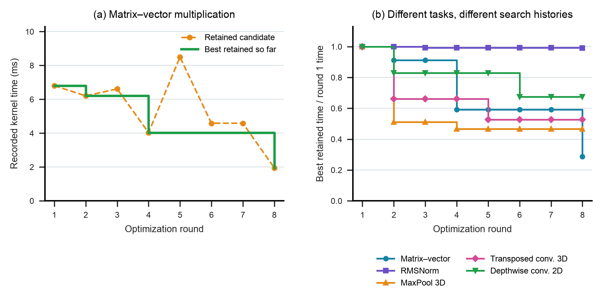

# Retained candidates and best-so-far kernel time

This figure turns a search loop into an inspectable record. The left panel shows the matrix–vector kernel's retained candidate at each round and the minimum time observed so far. The right panel applies the same calculation to all five tasks in the source repository, normalized to each task's first retained round.

**Placement.** Chapter 3, after “The Six Stages of the AI-Native Life Cycle,” as a retained search trace illustrating candidate regression and preservation of the best result alongside the explicitly prospective Lighthouse study. Chapter 5 can refer to it when discussing search budgets. Timings alone do not establish which feedback caused the next proposal. The trace does not demonstrate the whole six-stage life cycle or validate a complete design system.

**Why this figure.** The matrix–vector trace reaches 4.031 ms in round 4, then returns an 8.492 ms candidate in round 5. A system that retains its best result behaves differently from one that accepts its latest proposal. The other tasks expose different improvement histories under the same nominal round limit. This teaches a concrete property of the harness.

**Suggested caption.** Retained candidates can regress during search. (a) Matrix–vector timings vary across rounds while the best observed time decreases. (b) Best-so-far times, normalized to the first retained round, follow different trajectories across five curated tasks. Each round contains one retained worker from a four-worker search; the complete search history and timing uncertainty are unavailable.

**Alt text.** Two line charts show recorded kernel time by optimization round and normalized best-so-far time for five tasks. The matrix–vector candidate becomes slower in round five before improving in round eight. The other tasks improve at different rounds, and RMSNorm changes little.

## Source and scope

The [pinned repository](https://github.com/kaiming-cheng/kernelagent-optimization-artifacts/tree/56cf9183b527307538ccbe8f554a88502918d2d1) describes five curated KernelBench tasks on one H100. The measured quantity is the `time_ms` field in each retained `benchmark_results.json`. No README timing enters the plot. Round 1 is a proposed candidate, not the initial input kernel. These records do not establish a population success rate or an advantage over conventional search at matched cost.

The README cross-check found three disagreements beyond rounding. The transposed-convolution README gives 7.821 ms, whereas the best retained timing is 5.411904 ms. RMSNorm's reported winning round also differs. These may reflect different runs or measurement procedures; the artifacts do not establish the reason. `readme_crosscheck.json` preserves the discrepancy rather than resolving it by assumption. Treat this as an illustrative public record requiring an independent rerun before a performance claim becomes a centerpiece of the keynote.

## Reproduction

From the repository root, run `python3 data/studies/10-kernelagent-search/reproduce.py`. It checks source hashes, reconstructs `timings.csv`, emits `summary.json`, and creates SVG, PDF, and 300 dpi PNG figures using the book's plotting helper. No GPU or network is needed. `collect.py` can fetch missing sources at the pinned revision. It verifies every downloaded Git blob against `source_tree.json`.

`source_manifest.json` records source URLs, bytes, hashes, and the collection interval. `build_receipt.json` records software versions, shared style hashes, source and output hashes, and checks performed. Dependencies are Python, NumPy, Matplotlib, and Requests; exact build versions are in the receipt. GPU execution has not been repeated. The pinned tree contains no license file; review permission before redistributing the retained source code.
