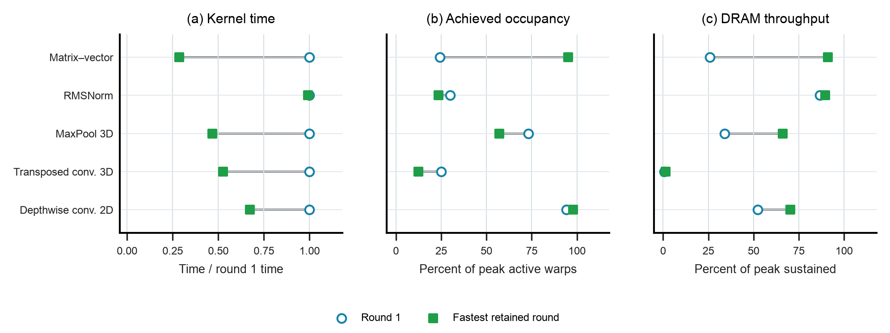

# Kernel time, occupancy, and DRAM throughput

The figure compares the first retained candidate with the minimum-time candidate among eight retained rounds for each task. It shows the timing ratio, achieved occupancy, and DRAM throughput from associated Nsight Compute records. Every plotted candidate has exactly one profiled kernel; percentages are never summed across kernels.

**Placement.** Chapter 7, “Qualifying Proxies and Calibration,” before the discussion of metric gaming. Chapter 4 can refer to the same artifact when motivating the representation of hardware feedback. Keep the main figure in one chapter.

**Why this figure.** MaxPool 3D becomes faster while its achieved occupancy falls from 73.29% to 57.18% and DRAM throughput rises from 33.92% to 66.00% of peak sustained. The matrix–vector candidate follows a different pattern. An agent that maximizes occupancy as its reward can therefore reject useful candidates. The figure motivates diagnosis and measurement of the actual objective; it does not prove which code change caused the improvement.

**Suggested caption.** Lower occupancy can accompany a faster kernel. The first retained candidate and fastest retained candidate differ in timing, achieved occupancy, and DRAM throughput across five curated tasks. Candidate selection uses all eight retained timing records per task. Associated profiler records provide diagnostic signals, not a causal decomposition of runtime; the small RMSNorm timing difference has no reported uncertainty.

**Alt text.** Three aligned dot plots compare the first and fastest retained candidates for five kernel tasks. Kernel time falls while occupancy rises for some tasks and falls for others. MaxPool 3D has lower occupancy and higher DRAM throughput in its faster candidate.

## Reproduction and limits

Run `python3 data/studies/11-kernelagent-feedback/reproduce.py` from the repository root. The folder retains every timing and output-profile record needed to repeat candidate selection, plus the associated source code. `collect.py` copies and verifies this subset from Study 10; Study 10's collector retrieves the original pinned GitHub files. Plotting itself is independent of that folder.

The source is the [same pinned KernelAgent repository](https://github.com/kaiming-cheng/kernelagent-optimization-artifacts/tree/56cf9183b527307538ccbe8f554a88502918d2d1). Hardware identity and toolchain context are author-reported. Profiling records identify Nsight Compute 2025.2.1.0. Raw field names are preserved in `reproduce.py`; `paired_metrics.csv` records the selected paths, kernel names, and values. SHA-256 receipts protect retained bytes, but the original profiler record does not contain a hash of the executed kernel. No GPU run or causal experiment was performed here.

The runtime environment and source/output hashes are in `build_receipt.json`. SVG, PDF, and PNG use the shared book style. No license file was present in the original tree, so permission to redistribute source code remains unresolved.
