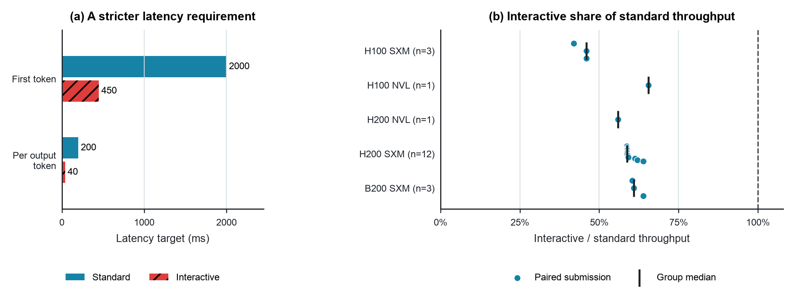

# Interactive and standard throughput on matched MLPerf submissions

The figure uses all 20 eligible pairs of standard and interactive Llama 2 70B Server submissions in the pinned MLPerf Inference v5.0 summary. Both conditions use one node, eight accelerators, and the 99% accuracy target. Each pair has the same submitter, platform, reported precision, and reported software.

**Placement.** Chapter 2, where architectural objectives and operating constraints motivate the design problem. Chapter 10 can refer back to it when defining comparable evaluations. It is also the strongest immediately usable keynote figure from this collection because all plotted timing values reconcile with retained run logs.

**What the figure shows.** Interactive targets reduce allowed first-token latency from 2,000 to 450 ms and per-output-token latency from 200 to 40 ms. Interactive throughput is 42.0–65.5% of the standard value in each pair. That share is not the capacity cost of the latency contract. Each share lies within 0.51% of the ratio of the two `target_qps` values in the pair's logs (correlation 0.9998), and no log reports a 99th-percentile latency at its bound: the larger of the two sits at 70.8–96.9% of its limit in standard logs and 88.3–99.5% in interactive logs. The median, 58.8%, is the ratio 67.2/114.24 used by nine H200 SXM pairs. These values are in `target_rate_tracking` and `latency_bound_share` in `summary.json`. What the logs do show directly is that no standard log meets the interactive bounds: the lowest standard 99th percentiles are 500.9 ms and 141.7 ms (`standard_logs_against_interactive_bounds`).

**Limit of that reading.** The v5.0 rules define the Server metric as the maximum Poisson rate supported, and they judge a run on an early-stopping estimate that the summary logs do not print. So a target can sit near a limit, and the closest logs may have little margin. A log holds one passing run and no failed run at a higher target. The logs show no forced limit; they do not show that none exists.

**Target rates in `user.conf`.** `check_user_conf.py` retains the 40 pinned `user.conf` files in `raw_user_conf/` and writes `user_conf_targets.json`. Nine agree with the log's `target_qps` and 31 differ: 27 at about 0.92 of the log value, and one each at about 0.73, 0.96, 1.02, and 1.03. The sources do not explain this, and no explanation is adopted here. The plotted values come from the logs.

**Caption.** The book caption in `02-pressures.qmd` is the current one. An earlier suggestion here said throughput depends on the required response time, which the data do not show.

**Alt text.** The book's `fig-alt` is the current one.

## Selection and reconciliation

`collect.py` starts from the [complete pinned summary](https://github.com/mlcommons/inference_results_v5.0/blob/0bc17ab3f4b33f730d7869e04cc29cb70835e513/summary_results.json), not the truncated GitHub recursive tree. It selects closed datacenter results with zero reported errors, compliance set to one, no inference from another scenario, one node, eight accelerators, Server scenario, and the standard or interactive Llama 2 70B 99% model. It pairs on submitter and platform and rejects duplicate model rows or mismatched reported hardware, software, precision, operating system, or availability. Unpaired systems are listed in the source manifest.

Rows dropped at each step, in order, from the 17,454 rows of the summary (`filter_counts` in `source_manifest.json` and `summary.json`, computed by `collect.py`):

| Filter | Dropped | Kept |
| --- | ---: | ---: |
| Server scenario, Llama 2 70B 99% standard or interactive | 17,383 | 71 |
| Closed division | 4 | 67 |
| Datacenter suite, zero errors, compliance, not inferred | 0 | 67 |
| One node | 1 | 66 |
| Eight accelerators | 9 | 57 |
| Both conditions present for one submitter and platform | 17 | 40 |

An earlier version also required `has_power` to be false. That filter was described as removing power-run duplication, but no system here has both a power and a non-power row for one model, so it duplicated nothing and silently removed the Fujitsu H100-NVL-94GB pair, whose only rows are power-measured. The pair passes every other filter, and the filter has been removed. Published counts moved from 19 pairs, 38 logs, and a 63.9% maximum to 20 pairs, 40 logs, and a 65.5% maximum; the median stays 58.8%. Earlier builds remain in `runs.jsonl`.

The collector retains 40 `mlperf_log_summary.txt` files and 20 system JSON files, together with the full summary, which is gitignored for size and refetched from the pinned commit, and the repository README. The plotted values come from the run logs. Each log reports VALID and satisfied performance constraints, and each throughput matches the published summary to its precision. These are submitted results rather than independent reruns. The system files do not establish that batch sizes, schedules, or all operating settings are identical between conditions. The comparison shows jointly configured service operating points; it does not isolate a causal penalty from changing one latency parameter.

The reported precision is FP8 for H100/H200 pairs and FP4 for B200 pairs. The plot normalizes within each pair and makes no cross-family efficiency claim. Several vendors may use shared implementations, so the dots are not independent replications and no confidence interval is shown. Nine H200 SXM pairs share target query rates of 114.24 and 67.2 and lie between 58.6% and 59.1%, and eleven of the 20 pairs share the interactive target 67.2, so the spread across pairs is a spread of chosen settings, not a separate fraction for every system. H100 NVL is one pair from one submitter, and why it differs from H100 SXM was not examined. The H100-NVL pair is the only power-measured pair.

The logs state the latency bounds but not their percentile. `loadgen/mlperf.conf` at tag v5.0 and `inference_rules.adoc` at inference_policies commit 61ca74a give the 99th percentile. Those rules name the classes Conversational and Interactive; this study and the results repository's model names use standard for the first.

## Reproduction

Run `python3 data/studies/12-mlperf-latency-contract/reproduce.py` from the repository root. `check_user_conf.py` regenerates `user_conf_targets.json`. `reproduce.py` verifies retained hashes, reconciles the logs with the selected summary rows, emits `paired_throughput.csv` and `summary.json`, and generates the SVG/PDF/300 dpi PNG bundle using the book's plotting helper. `collect.py` retrieves missing sources at the immutable commit and reconstructs pair selection. Runtime package versions, shared style hashes, source hashes, and output hashes are retained in `build_receipt.json`.
