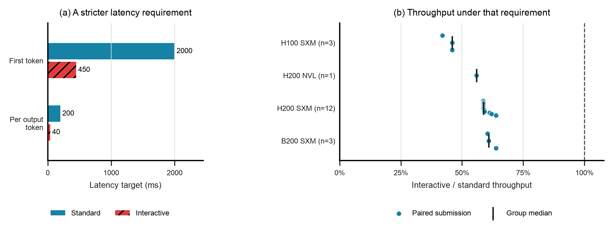

# Throughput depends on the latency contract

The figure uses all 19 eligible pairs of standard and interactive Llama 2 70B Server submissions in the pinned MLPerf Inference v5.0 summary. Both conditions use one node, eight accelerators, and the 99% accuracy target. Each pair has the same submitter, platform, reported precision, and reported software.

**Placement.** Chapter 2, where architectural objectives and operating constraints motivate the design problem. Chapter 10 can refer back to it when defining comparable evaluations. It is also the strongest immediately usable keynote figure from this collection because all plotted timing values reconcile with retained run logs.

**Why this figure.** Interactive targets reduce allowed first-token latency from 2,000 to 450 ms and per-output-token latency from 200 to 40 ms. Throughput in the paired submissions falls to 42.0–63.9% of the standard value, with a median of 58.8%. The same model and named system therefore need different performance expectations under different service requirements. This makes problem formulation quantitatively consequential.

**Suggested caption.** Throughput depends on the required response time. (a) MLPerf's interactive Llama 2 Server condition tightens first-token and per-output-token latency targets. (b) Across all 19 eligible eight-accelerator pairs, interactive throughput is 42–64% of standard throughput. Points are paired submissions; bars mark group medians. Software and precision match within pairs, but operating configurations may differ.

**Alt text.** A bar chart compares standard and interactive latency targets, and a dot plot shows throughput ratios for nineteen paired submissions grouped by accelerator family. Interactive throughput ranges from about forty-two to sixty-four percent of standard throughput, with a median near fifty-nine percent.

## Selection and reconciliation

`collect.py` starts from the [complete pinned summary](https://github.com/mlcommons/inference_results_v5.0/blob/0bc17ab3f4b33f730d7869e04cc29cb70835e513/summary_results.json), not the truncated GitHub recursive tree. It selects closed datacenter results with zero reported errors, compliance set to one, no inference from another scenario, no power-run duplication, one node, eight accelerators, Server scenario, and the standard or interactive Llama 2 70B 99% model. It pairs on submitter and platform and rejects duplicate model rows or mismatched reported hardware, software, precision, operating system, or availability. Unpaired systems are listed in the source manifest.

The collector retains 38 `mlperf_log_summary.txt` files and 19 system JSON files, together with the full summary and repository README. The plotted values come from the run logs. Each log reports VALID and satisfied performance constraints, and each throughput matches the published summary to its precision. These are submitted results rather than independent reruns. The system files do not establish that batch sizes, schedules, or all operating settings are identical between conditions. The comparison shows jointly configured service operating points; it does not isolate a causal penalty from changing one latency parameter.

The reported precision is FP8 for H100/H200 pairs and FP4 for B200 pairs. The plot normalizes within each pair and makes no cross-family efficiency claim. Several vendors may use shared implementations, so the dots are not independent replications and no confidence interval is shown.

## Reproduction

Run `python3 data/studies/12-mlperf-latency-contract/reproduce.py` from the repository root. It verifies retained hashes, reconciles the logs with the selected summary rows, emits `paired_throughput.csv` and `summary.json`, and generates the SVG/PDF/300 dpi PNG bundle using the book's plotting helper. `collect.py` retrieves missing sources at the immutable commit and reconstructs pair selection. Runtime package versions, shared style hashes, source hashes, and output hashes are retained in `build_receipt.json`.
