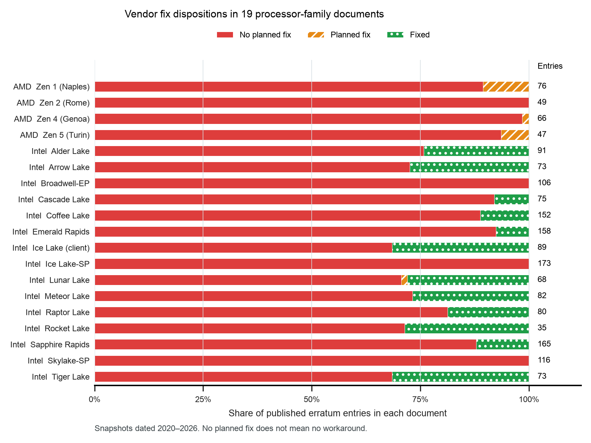

# Published errata and vendor fix dispositions

The 19 retained vendor documents contain 1,774 family/erratum entries. Of these,
1,547 carry no planned fix, 13 carry a planned fix, and 214 are marked fixed.
The 87.2% share describes these published records. It does not measure the
fraction of shipped chips that are defective, the severity of defects, or the
availability of software workarounds.



## Placement and purpose

Use this figure in Chapter 11, “Sustaining Architectural Ownership,” where the
argument moves from commitment to continuing responsibility. It gives the reader
a concrete reason to preserve operating restrictions, diagnostic paths, and
support obligations after shipment. It is also a possible keynote substitute for
the existing subsystem-classification figure. The disposition plot depends on
explicit vendor fields rather than model-assigned subsystem labels.

The existing subsystem plot answers a different question. Prefer one figure in
the main discussion and retain the other as supporting material; adding both
without separate argumentative jobs would make the chapter heavier.

**Suggested caption.** Published errata often remain without a planned fix.
Vendor-reported dispositions for 1,774 entries in 19 Intel and AMD processor-family
documents dated 2020–2026. Where dispositions differ across steppings, the
extraction retains the least resolved status. Counts refer to documented entries,
which can recur across families. No planned fix does not imply no workaround.
Document age, product scope, and disclosure practice preclude vendor-quality or
generation-quality comparisons from these proportions.

## Sources and the revision check

The source URLs, document identities, and SHA-256 receipts are in
[`source_manifest.json`](source_manifest.json); current extracted document
metadata are in [`derived/sources.csv`](derived/sources.csv). All 19 PDFs were
downloaded for this pass. Eighteen match the earlier study byte for byte.
Raptor Lake changed from revision 031 (September 2026) to 032 (October 2026).
Re-extraction preserves all 80 IDs, titles, and dispositions for that family;
only the revision field changes in the extracted records. This does not assert
that every other part of the document is unchanged.

[`snapshot_changes.json`](snapshot_changes.json) retains every extracted-field
difference. The original study and its 1,774-row input remain unchanged.

## Reproduction

Run from the repository root with Python, Matplotlib, NumPy, requests, PyMuPDF,
curl, and Poppler available:

```sh
python3 data/studies/13-errata-dispositions/collect.py
python3 data/studies/13-errata-dispositions/reproduce.py
```

Collection verifies existing pinned bytes. On a fresh machine it downloads the
vendor URLs and refuses bytes that differ from this study's manifest. The PDFs
are retained locally in `raw/pdf/`; they are excluded from Git because the source
documents do not supply a redistribution license. Preserve that directory in a
private archive for long-term reproduction of revisions a vendor later replaces.

Reproduction runs a retained copy of the original miner against those PDFs,
checks ID completeness against summary tables, removed-entry consistency,
numbering gaps, and available title fragments, then calculates and plots the
dispositions. It never writes into study 01. `build_receipt.json` records package
versions and input, script, style, and output hashes. The extraction header also
records Poppler and PyMuPDF versions.

## Verification limits

All 19 document completeness checks pass. Six rendered source pages were
inspected: Intel examples of fixed, planned-fix, and no-fix entries; AMD examples
of planned-fix and no-fix entries; and the revised Raptor Lake title page. The
sample and page numbers are retained in `source_visual_qa/sample.csv`.
This purposive spot check is not an independent audit of all 1,774 entries.

The earlier workaround-text counts remain withdrawn. Body-field boundaries and
subsystem classifications are not used here. Published errata are not a complete
inventory of defects, and a publication date alone cannot establish when a defect
was discovered or whether it escaped a particular verification process.

Both the PNG figure and a rasterization of the vector PDF were visually inspected.
