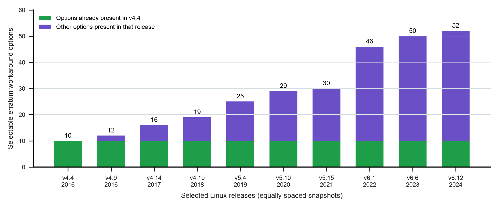

# Hardware workarounds in Linux

Ten pinned Linux releases show 10 selectable arm64 erratum workaround options in
v4.4 and 52 in v6.12. All ten options present in v4.4 remain in every sampled
release through v6.12, nearly nine years later. This is a measured source-code
inventory of continuing software support obligations.



## Placement and purpose

Place the figure in Chapter 9, “Version Dependencies and Interface Contracts,”
with a concrete example from the retained Kconfig help text. For
`ARM64_ERRATUM_819472`, the source names Cortex-A53 revisions through r0p1,
cache and interconnect conditions, and a change to cache-maintenance operations.
The help text also distinguishes compiling support from applying it to an
affected CPU. Those conditions show what an architect must carry with a reused
workaround. Chapter 11 can refer back when discussing continuing ownership.

For the keynote, this is the strongest new errata example. A small source excerpt
after the plot can make the architectural question concrete: which hardware,
revision, and operating conditions make this transformation necessary?

**Suggested caption.** Hardware workarounds remain part of the operating system.
The number of named, explicitly prompted erratum options in
`arch/arm64/Kconfig` rises from 10 in Linux v4.4 to 52 in v6.12 across ten selected
release snapshots. All ten original options remain present in every sampled
release. Equal spacing denotes selected releases, not equal time intervals.
These are configuration options, not distinct defects, affected processors,
engineering hours, or measured performance costs.

## Source, selection, and reproduction

The source is [the Linux repository](https://github.com/torvalds/linux).
[`pins.json`](pins.json) records full commit identities and commit dates for
v4.4, v4.9, v4.14, v4.19, v5.4, v5.10, v5.15, v6.1, v6.6, and v6.12.
The final release is pinned at
[`adc218676eef25575469234709c2d87185ca223a`](https://github.com/torvalds/linux/tree/adc218676eef25575469234709c2d87185ca223a).
The series is historical and makes no claim about the latest kernel.

Every included symbol contains an `ERRATUM` or `ERRATA` word segment and has an
explicit `bool` prompt. The complete inclusion/exclusion table preserves symbols,
prompts, release commits, and source line numbers. This excludes linker capability
helpers and generic implementation helpers; it also excludes workarounds without
a selectable option and source files outside the stated path. Different supported
CPU populations and maintenance policies can change the inventory.

```sh
python3 data/studies/14-linux-errata-workarounds/collect.py
python3 data/studies/14-linux-errata-workarounds/reproduce.py
```

Python, requests, NumPy, and Matplotlib are required. The collector uses existing
pins, fetches commit-qualified raw source URLs, and preserves SHA-256 receipts.
Kconfig, the CPU-errata implementation, and license notices are retained for every
release. Linux licensing notices are in `raw/*/COPYING`; the v6.12 GPL-2.0 text
is retained as well. Preserve applicable source notices when redistributing.

## What was checked

All 43 source/identity files pass their hash checks. Every `config` block is parsed
before selection, symbols are unique within a release, and all ten original
symbols are compared with every selected release. `options.csv` permits a direct
line-level audit; `release_counts.csv` contains the plotted values. No kernel was
built and no workaround performance penalty was measured.

The v6.12 documentation registry was separately extracted into `registry.csv`.
It has a broader scope and does not exactly match the selected Kconfig symbols.
For example, the document names `QCOM_FALKOR_ERRATUM_1041`, while Kconfig names
`QCOM_FALKOR_ERRATUM_E1041`. These differences remain in `summary.json`; the
documentation table is not substituted for the source inventory. The plot does
not count registry rows or infer one defect per configuration option.

The PNG and the rasterized vector PDF were inspected for legibility and clipping.
