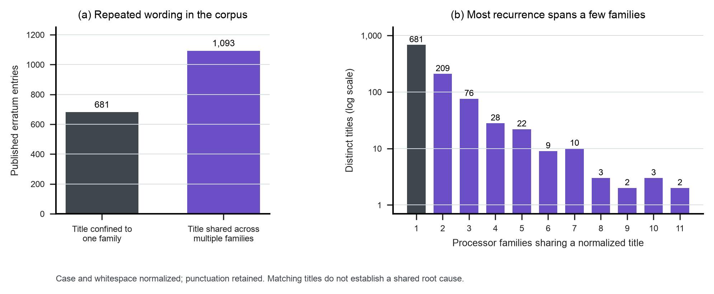

# Repeated titles in an architecture dataset

The 1,774 vendor erratum records contain 1,045 distinct titles after Unicode,
case, and whitespace normalization. Of the records, 1,093 (61.6%) have a title
that appears in more than one processor family. The result measures recurring
wording. It does not establish identical root causes or independent sample size.



## Placement and purpose

Place this figure in Chapter 4, “Constructing Architecture Datasets,” near the
discussion of sample definition, deduplication, and evaluation partitions.
It gives students an actual architectural corpus on which to distinguish a row,
a document, a processor family, a repeated description, and a hardware defect.
Grouping related records before constructing train/test partitions becomes an
engineering decision with visible consequences.

For a later lab, students can compare record-level and grouped partitions, then
inspect cases where matching titles still have different applicability conditions.
That experiment is proposed; no model was trained and no train/test leakage rate
was measured here. The grouping shown in the plot is a text-screening rule, not
a sufficient rule for establishing defect identity.

**Suggested caption.** Erratum records contain repeated descriptions across
processor families. Among 1,774 entries from 19 vendor documents, 1,093 share a
normalized title with another family. The right panel counts distinct titles by
the number of families in which they occur; its vertical axis is logarithmic.
Normalization preserves punctuation and numbers while standardizing Unicode,
case, and whitespace. Repeated wording signals a need to inspect related samples;
it does not establish a shared hardware root cause.

## Reproduction and provenance

This analysis uses the freshly extracted titles from
[study 13](../13-errata-dispositions/README.md). Its raw PDFs, extraction script,
document identities, and checks are stored once there. Keep the two study
directories together. This directory retains its own input CSVs and a hashed copy
of the shared source manifest.

```sh
python3 data/studies/13-errata-dispositions/collect.py
python3 data/studies/13-errata-dispositions/reproduce.py
python3 data/studies/15-errata-title-reuse/collect.py
python3 data/studies/15-errata-title-reuse/reproduce.py
```

`title_groups.csv` gives every group, its member family/erratum IDs, and the exact
normalized title. `title_multiplicity.csv` supplies the right panel.
`summary.json` includes normalization sensitivity: literal matching gives 1,094
distinct titles and 1,028 entries with titles shared across families; the plotted
case/whitespace rule gives 1,045 and 1,093; removing all non-alphanumeric
characters gives 1,036 and 1,103. The stricter plotted rule avoids erasing
punctuation that can matter to hardware names and conditions.

Hash checks cover the local input files and the shared vendor package. Group
membership covers every input record. Neither subsystem classification nor the
known-unreliable workaround body fields are used. Visual inspection covered both
the PNG and a rasterization of the vector PDF.
