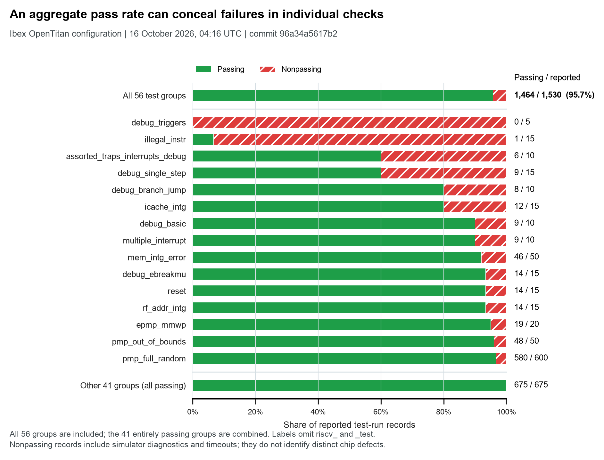

# Individual checks behind an aggregate regression score

One public Ibex regression report records 1,464 passing test runs out of 1,530,
or 95.7%. Its 56 test groups include `riscv_debug_triggers_test` at 0/5 and
`riscv_illegal_instr_test` at 1/15. The figure shows every group with a nonpassing
record and combines the other 41 groups, whose 675 reported records all pass.
The aggregate is weighted by reported runs, not by test groups.



## Placement and claim

Place this in Chapter 7 when explaining the scope of verification evidence.
Chapter 6 can refer to it when describing the records a harness must preserve.
An aggregate score cannot answer whether a particular required behavior passed
its checks. The example gives that distinction an observable consequence in a
real RISC-V verification flow. It does not compare agent workflows or establish
that AI improves verification.

Suggested caption: **Individual checks behind an aggregate score.** The retained
Ibex OpenTitan-configuration report dated October 16, 2026, at 04:16 UTC reports
95.7% passing runs overall. Fifteen test groups contain nonpassing records; the
41 entirely passing groups are combined in the final row. Counts are reported
test-run records, and different groups have different denominators. Nonpassing
records include simulator diagnostics and timeouts and do not identify distinct
hardware defects. Source: lowRISC public regression report, retained response
and generator commit `96a34a5617b2904f4172a350199217d82359c13b`.

## Source and reproduction

The [public report](https://ibex.reports.lowrisc.org/opentitan/latest/report.html)
uses a mutable `latest` address. Its exact bytes, internal timestamp, and commit
are retained in [the source manifest](source_manifest.json). The companion JSON
agrees with all 56 HTML group counts. These are two formats from one pipeline,
not independent experiments. The JSON lacks the HTML's timestamp and revision.

From the repository root:

```sh
python3 data/studies/16-regression-records/reproduce.py
```

This verifies retained source hashes and response headers, extracts the tables,
reconciles all 66 nonpassing records with distinct failure-detail blocks, and
builds SVG, PDF, and PNG figures using the book's style. It requires Python,
NumPy, Matplotlib, and Requests as used by the shared build-receipt helper.
No simulation or model call is made. The default collector reuses the frozen
snapshot. It refuses changed bytes; fresh captures require a separate directory.
HTTP headers are also pinned, so recovery can refuse a response with identical
body bytes but changed headers. Preserve the retained sources for offline use.

`derived/test_summary.csv` retains full test names and integer counts.
`derived/plot_rows.csv` maps every displayed row to those names.
`derived/failure_details.csv` retains failure identifiers and diagnostics.
`derived/extraction_audit.json` records reconciliation and the HTML/JSON check.
`build_receipt.json` records source, script, output, and shared-style hashes.

## Limits

The denominator covers the records in this report. It is not a census of all
scheduled jobs, build attempts, or generator attempts. Passing run identifiers,
an immutable upstream report URL, and a CI job identifier are unavailable here.
The failure details identify `test_name.seed`; repeated seed values in different
groups are not collapsed. The data do not establish independent trials or a
probability of future correctness.

The diagnostic strings have not been assigned hardware root causes. One defect,
testbench condition, tool problem, or configuration issue could affect multiple
records. The recorded coverage percentages are retained separately and are not
plotted because the underlying coverage populations are not exposed in this
report. A before-and-after fix experiment would require additional evidence.

OpenTitan dashboard snapshots are retained as discovery material. The top-level
Earlgrey `latest` report carries a February 8, 2025 timestamp. Its retrieval date
must not be presented as its execution date, and its counts are not pooled here.
