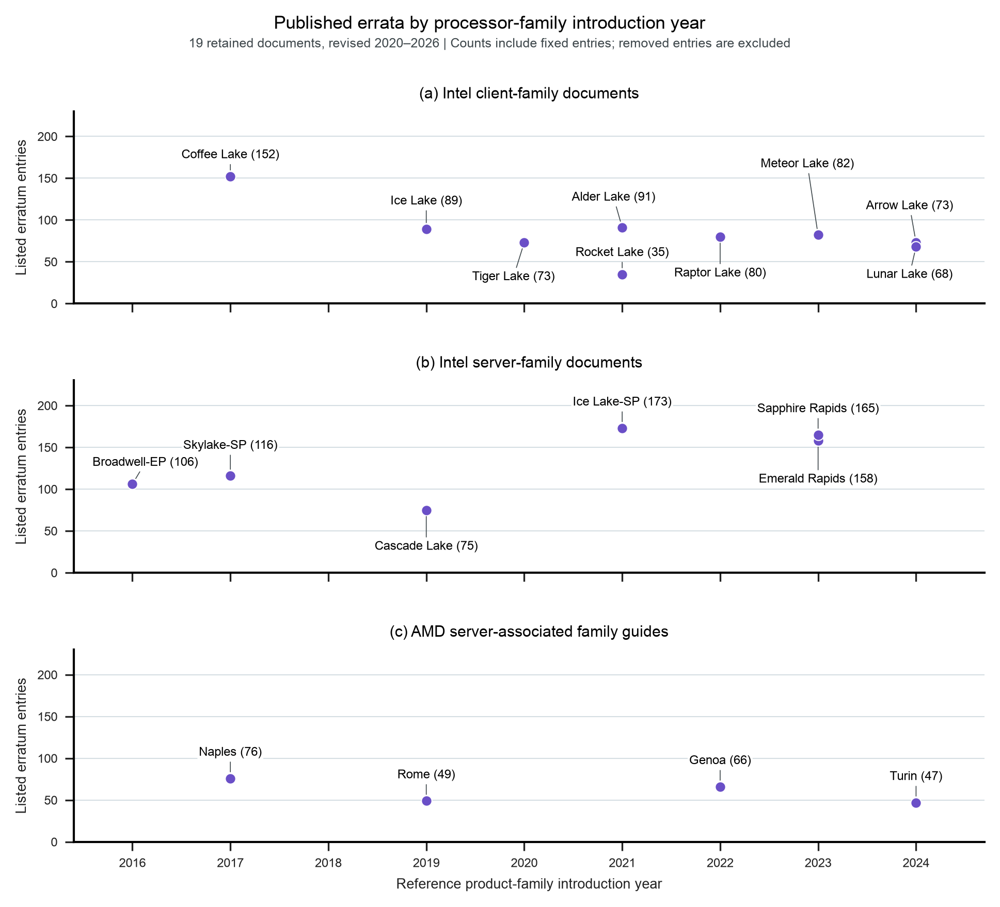

# Errata by processor-family introduction year

This figure locates the 19 retained processor-family documents on a product
timeline. Each point counts the erratum entries still listed in that document,
including entries marked fixed. It is a view of the existing 1,774-entry corpus,
with introduction years checked against official Intel and AMD sources.



The x coordinate is the named reference family's introduction year. It is not
the document revision year or the year each erratum was discovered. Document
revisions span 2020–2026, while the reference families were introduced in
2016–2024. The source date and document revision remain in each data row.

## What this view can establish

The figure provides historical orientation. It shows the range of published
inventories in this selected corpus and identifies families for closer study.
It cannot establish a trend in chip quality, defect density, or verification
effectiveness. Documents differ in product scope, age, disclosure practice, and
revision history. The collection is not an exhaustive census of chips in any
year. Counts are not pooled into annual industry totals or fitted with a trend.

The AMD panel is labeled as server-associated because its revision guides cover
processor-family/model ranges. In particular, the Naples-associated guide also
covers Threadripper products. Coffee Lake spans 8th- and 9th-generation desktop
Core products; Raptor Lake spans 13th and 14th generations and later extensions.
Their plotted year locates the first named reference family, not all covered
silicon. Launch dates can describe an announcement before retail availability;
only the year is used. Skylake-SP has year-only evidence in the retained source.

**Suggested caption.** Published errata located by product-family introduction
year. Each point counts entries in one retained document, including fixed
entries and excluding entries marked removed. The differing document dates and
product scopes prevent interpreting the plot as a trend in defect incidence.

**Placement.** Use this as supporting material for Chapter 11 or an appendix.
For the main argument about continuing architectural responsibility, the
[revision-history figure](../19-errata-history/README.md) is stronger.

## Sources and reproduction

`launch_years.csv` contains the 19 manually checked year assignments, source
excerpts, scope notes, and source hashes. The complete official pages are in
`launch_sources/`; its manifest records URLs and retrieval metadata. The
generated `family_year_counts.csv` joins those dates with study 13's retained
vendor records. No chip family is excluded from that join.

```sh
python3 data/studies/18-errata-by-year/collect.py
python3 data/studies/18-errata-by-year/reproduce.py
```

Collection verifies frozen bytes and restores a missing public source only if
its hash matches. Rendering uses local data and the book's shared Matplotlib
style. Study 13 must be available alongside this package; its source hashes are
checked as well. Python, Matplotlib, NumPy, and Requests are required by the plot
and receipt helper; source PDF inspection additionally used PyMuPDF.

The four retained launch-source PDFs are kept locally and excluded from Git
pending redistribution review, following the vendor-PDF practice in study 13.
Preserve them with the private source archive. Both the PNG and rasterized PDF
were visually inspected. Source identity and arithmetic checks do not establish
that published errata exhaust the underlying defects.

## Which errata plots are worth using

| View | Architectural question | Recommendation |
|---|---|---|
| Counts by introduction year | Which product generations do these records describe? | Supporting context; generated here. |
| Additions by document revision year | How long does the published record continue changing? | Strongest new main-text view; generated in study 19. |
| Workaround retention across Linux releases | How long does software retain hardware-specific obligations? | Strong keynote companion; already generated in study 14. |
| Fix disposition by family | What obligations remain after product commitment? | Use study 13 with its distinction between no fix and no workaround. |
| Workaround cost on a fixed workload and machine | What performance, energy, or functionality does containment cost? | Highest-value next measurement; source counts cannot supply it. |
| Errata by subsystem across generations | Which architectural interfaces keep causing difficulty? | Defer until the subsystem assignments receive an independent semantic audit. |

For the keynote, use one revision-history example beside one concrete software
workaround. The resulting question is what an AI-native design system must
remember and recheck when the processor revision, workload, or operating context
changes. A historical count alone does not answer that question.
