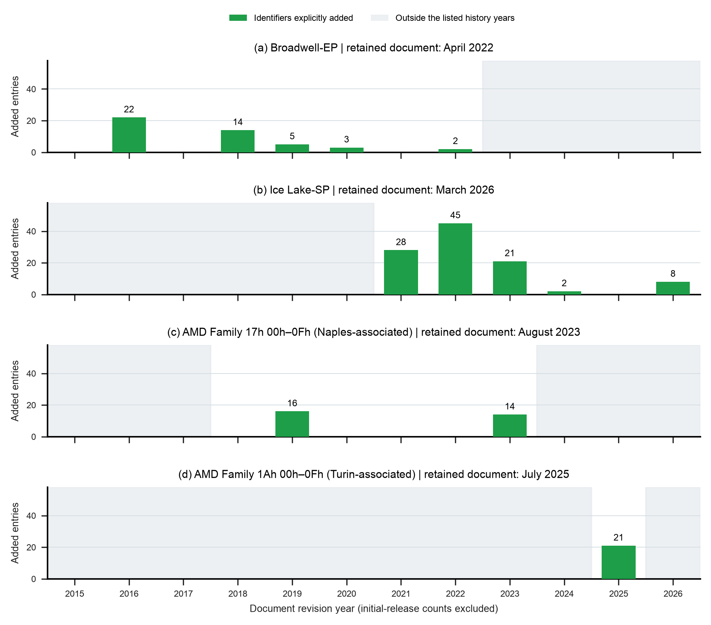

# Errata additions by document revision year

These four histories show erratum identifiers explicitly listed as additions
in retained Intel and AMD revision tables. They answer a temporal question
that the current inventory cannot: when did the publisher record additions
to this document? They do not establish when a defect was discovered.



**Suggested caption.** Errata records continue to change after product
introduction. Bars count identifiers explicitly added in the listed revision
rows; initial inventories are excluded. Gray areas lie outside each table's
listed history years. A blank year does not establish that no defects were
found. These selected histories are incomplete records of document changes.

## Placement and interpretation

Place this in Chapter 11's discussion of continuing architectural ownership.
For a keynote, the Ice Lake-SP example is sufficient: the product family was
introduced in 2021, and its retained revision history lists eight additions in
2026, through March. The source is a published engineering record, not a model
classification. The [introduction-year package](../18-errata-by-year/README.md)
retains the official Intel source for the product date.

The lesson is that a committed design does not end the need to qualify its
operating conditions. An AI-native design system that retrieves an old record
must preserve the source revision and determine whether later information
changes its recommendation. The history supports this continuing obligation;
it does not demonstrate that an AI method can discharge it.

## What was extracted

All 40 visible rows in the selected revision-history tables are retained with
document, page, date, revision, description, and expanded identifier sets.
Explicit additions, removals, and updates are counted separately. Number ranges
are expanded inclusively. An identifier following a duplicate-reference clause
is not counted as another removal. The plotted annual additions total 46 for
Broadwell-EP, 104 for Ice Lake-SP, 30 for the Naples-associated guide, and 21
for the Turin-associated guide. These totals are not pooled across products.

The selection is illustrative: two Intel server specification updates and two
AMD family guides with directly inspectable revision tables. It is not a random
sample or an exhaustive history. AMD guide scope can exceed the named server
family. The plotted periods end at different document dates and include partial
calendar years. No annual rate or vendor comparison is inferred.

## Source limits that affect the plot

- Broadwell's history dates an initial document release to May 2015. That is
  not used as a chip launch date. Its revision 003 adds BDF86–BDF99, but the
  current document marks BDF92 removed without dating that removal in the
  history. Its additions can be counted; a complete cumulative inventory
  cannot be reconstructed from the dated table alone.
- Ice Lake-SP's retained history begins at revision 003US in July 2021.
  Earlier revisions and the initial inventory are unavailable in this table.
- The Naples-associated guide lists revisions 1.12, 1.16, 1.17, and 1.21.
  Revision-number gaps are preserved; no dates or counts are invented.
- An initial-release row does not enumerate the initial errata. These baseline
  counts are excluded. Three histories are consistent with the final ID set
  under an inferred residual baseline, but that arithmetic does not make the
  baseline a dated observation.

The annual table distinguishes years with no listed revision row from listed
rows that add no identifiers. White space in the chart means no additions are
recorded in the extracted rows, not evidence of no defects or no undisclosed
changes. Gray shading denotes calendar years outside the table's endpoint years;
it does not imply that every month inside those endpoint years was observed.

## Reproduction and provenance

```sh
python3 data/studies/19-errata-history/reproduce.py
```

The script reads the four frozen PDFs and metadata in study 13, verifies source
hashes, re-extracts tables using PyMuPDF, and renders with the shared book style.
Study 13 must be retained alongside this folder. If a PDF is missing, its
collector can recover it only when the public response matches the pinned hash;
preserve the private archive because vendor URLs can replace old revisions.

`revision_rows.csv` and `history_rows.json` retain the source rows.
`range_expansions.csv` makes each range calculation visible.
`identifier_events.csv` separates actions by identifier.
`annual_counts.csv` contains the plotted data and missing-row indicators.
`final_id_reconciliation.json` records the residual-baseline check and the
Broadwell mismatch. `source_manifest.json` provides URLs and hashes; the raw
PDFs remain in study 13. `source_visual_qa/` retains the four inspected history
pages. Both figure formats were inspected through PNG rendering.

Requirements are Python, PyMuPDF, Matplotlib, NumPy, and Requests. The current
PyMuPDF table extraction is recorded in `build_receipt.json` alongside script,
data, shared-style, and output hashes. No silicon experiment was performed.
