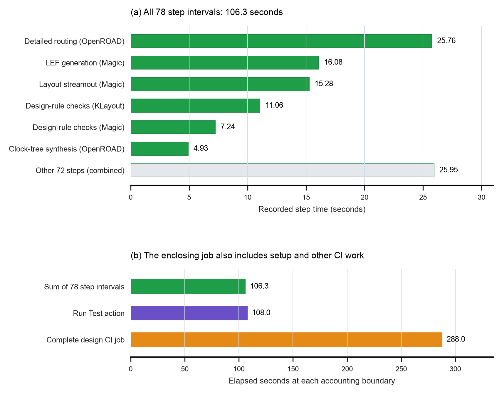

# Measured physical-design stage cost: one LibreLane CI run

This study retains one complete LibreLane design-test artifact and extracts its
stage wall times and subprocess resource records. It is a worked cost-accounting
example for Chapter 6. The selected case is the `spm` design on IHP SG13G2
standard cells because its successful CI job retained a complete end-to-end
run directory. It was not selected as a best result, a winning design, or a
comparison point.



## Figure and placement

Place the figure in Chapter 6 near “Execution Records” or resource accounting.
Chapter 2 can refer to it when explaining the cost of obtaining a result.
The lesson is that the budget and the reported time need the same boundary.
The six longest steps and all other steps account for the complete outer-step
sum. The second panel compares that sum with enclosing action and job intervals;
these intervals overlap and must not be added.

**Suggested caption.** A time claim depends on its accounting boundary.
(a) Measured wall time for the six longest steps and the remaining 72 combined
in one completed LibreLane `spm` / IHP SG13G2 run. (b) The step sum sits inside
the test action and complete design CI job, which also includes setup and other
work. Intervals are nested, and one selected run does not establish general
stage costs. [Source job](https://github.com/librelane/librelane/actions/runs/37749124131/job/113223652131).

**Alt text.** Two horizontal bar charts show recorded elapsed time in one
physical-design CI job. Detailed routing is the longest individual flow step.
The 78 outer flow steps total about 106 seconds, while the test action takes
108 seconds and the complete design job takes 288 seconds.

## Declared population and run identity

The population is exactly one GitHub Actions job: **Test Design spm
(ihp-sg13g2/sg13g2_stdcell)**, workflow run `37749124131`, job
`113223652131`, completed successfully on 2026-10-08. The source commit is
`36aa197408e1b6508fc4862b7758d21ec8853048`; its `test/designs` submodule is
pinned to `librelane-ci-designs` commit
`2c0686e401e088e2bcad030b431bbf3a7213e3ea`. The original artifact is
`spm-ihp-sg13g2-sg13g2_stdcell`, artifact ID `11539925672`. The workflow run,
job, and artifact metadata responses are retained under `raw/`.

The compressed artifact contains 915 ZIP entries, 78 numbered flow-step directories,
78 direct-step `runtime.txt` records, and no duplicate archive paths. The
composite repair-antenna step also contains two nested substep runtime files;
the extractor leaves those out of the direct-step sum to avoid counting their
time twice. It emits every numbered step, including stages without child
process telemetry. The `runtime.txt` total is 106.292 seconds across the 78
serial step intervals. This is the flow's measured step time, not the full CI
job duration: the job ran from 09:02:40 to 09:07:28 UTC (288 s), while its
`Run Test` action ran from 09:05:33 to 09:07:21 UTC (108 s). The intervals
around cache and runner setup are outside the 106.292-second step sum.

The longest measured step intervals were detailed routing (25.759 s), Magic
write-LEF (16.083 s), Magic streamout (15.277 s), KLayout DRC (11.059 s), and
Magic DRC (7.240 s). These values describe this one run and its CI runner, not
general stage rankings or expected costs for another design.

## Measurements and limits

`runtime.txt` is written by LibreLane around `Step.run` and state validation.
It measures the whole step's wall interval. The pinned implementation is
retained at `source/librelane/step.py`; it starts the timer immediately before
input validation and ends it after the step returns and its output state is
validated and written. `*.process_stats.json` files are separate telemetry
from monitored child processes. They record subprocess wall time, user/system
CPU time, peak and average RSS/VMS, CPU percentage, and thread count. Do not
add subprocess runtime to the enclosing step runtime. For a stage with multiple
process-stat records, `stage-costs.csv` reports the largest observed child peak
for each resource; `process-costs.csv` preserves each child record separately.

The artifact has 55 process-stat files across 45 of the 78 steps. The other 33
steps still have wall-time records, but have no retained process-stat file;
their subprocess memory is unknown, not zero. The file-level process sample
is not a whole-job memory trace or a proof that each stage's complete process
tree was sampled.

The retained step configs identify LibreLane `3.1.0.dev3`, design `spm`, PDK
`ihp-sg13g2`, standard-cell library `sg13g2_stdcell`, PDK source pin
`22f43352dd8219f9007eb659e422e0d5fe28c5fb`, and a 10 ns clock period. Logs
identify Yosys `0.69` (git `9f75ca1f9834a39a863915b5dae0c7b1e33533bc`),
Verilator `5.046` (`v5.046`), and Magic `8.3` revision `677`. OpenROAD,
KLayout, and Netgen versions are not printed in the retained run outputs; the
source revision and Nix lock are preserved, but those run-time version strings
remain unknown. The per-step resolved configs retain the active timing corners,
clock constraints, layer limits, and PDK library paths.

The CI job succeeded. The final flow metrics also report zero final route DRC
errors, zero Magic DRC errors, zero KLayout DRC errors, zero LVS errors, and a
unique circuit match. The same final metrics report one flow warning (`ORD-0039`)
and ten detailed-routing warnings (`DRT-0349`); they must remain visible when
interpreting the result. CI success here means this run's configured flow and
checks completed. It does not establish a good PPA result or improvement over a
baseline: this extraction has no matched alternative, multi-run distribution,
or architecture decision record. The retained `warning.log` additionally records
fallback timing constraints, unsupported enclosure constructs, a skipped long-wire
check because its threshold is unset, and missing voltage-source locations that
may affect IR-drop analysis. These warnings are another reason not to interpret
job completion as comprehensive physical signoff.

## Reproduction

The original artifact ZIP and its API digest are retained in `raw/`. The ZIP
SHA-256 is
`f638d2a9198ee9e1595897a671edbe148fe41ded0eff926dc8cf9bb88a266094` and matches
GitHub's artifact digest. `source_manifest.json` lists the pinned public source
URLs and identities. `collect.py` verifies existing inputs and recovers a missing
file only after its downloaded bytes match the frozen hash. The compatibility
wrapper `collect_artifact.sh` calls that collector. Recovery of the ZIP requires
an authenticated GitHub CLI and an unexpired upstream artifact; mutable API
receipts may no longer be recoverable byte for byte. Retain the local snapshot.
Once the sources are present, extraction and plotting are fully offline:

```sh
python3 data/studies/20-implementation-stage-costs/reproduce.py
```

The extractor writes `stage-costs.csv`, `process-costs.csv`, and `summary.json`
from the ZIP. The plotter also computes `time_boundaries.json` from the saved
API records, emits `plot_rows.csv`, and renders SVG, PDF, and 300-dpi PNG twins
using the book's shared style. `sha256-manifest.txt` and `build_receipt.json`
record the retained inputs, scripts, outputs, dependencies, and checks. The
PNG and a raster of the PDF were visually inspected.

## Source ownership and claim boundary

LibreLane owns the CI workflow, the flow implementation, and the outputs from
this configured run. This packet supports a narrow factual claim that a public
physical-design CI run retained measured per-step wall time and subprocess
resource records for the selected design and versioned configuration. It does
not support an industry-wide stage-cost distribution, failure rate, comparison
between tools or design alternatives, cost of AI assistance, or a claim that
design-stage time is the dominant cost of architecture exploration.
