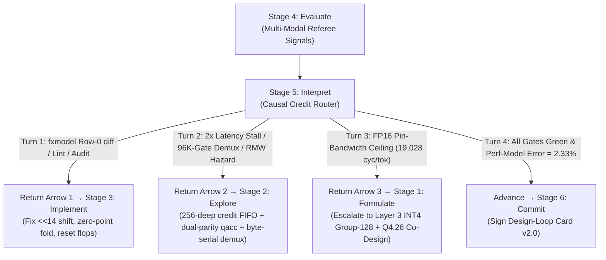

# Lab 05 — Stage 5: Interpret (`05-interpret`)

**Title:** *Causal Credit Assignment & The Three Return Arrows*
**Lifecycle Stage:** `5. Interpret`
**Book Alignment:** Part III — *The Loop in Action* (Chapter 3: *The AI-Native Design Life Cycle*, Chapter 6: *Execution Harnesses and Tool Isolation*, Chapter 9: *Pattern Transferability and Generalization*)
**Target Artifact:** [`nanochip/kpu/rtl/msh_gemv.v`](../../kpu/rtl/msh_gemv.v), [`nanochip/kpu/rtl/msh_fetch.v`](../../kpu/rtl/msh_fetch.v), [`nanochip/kpu/rtl/msh_deq.v`](../../kpu/rtl/msh_deq.v), [`nanochip/kpu/harness/evaluate.py`](../../kpu/harness/evaluate.py)

---

## 1. What Breaks Without This Stage: The Blind Retry Trap

Most first-generation "agentic RTL" frameworks wire a compiler or simulator directly back into an LLM prompt:
```text
while not pass:
    rtl = llm("Here is the error log. Fix the Verilog.")
```
Chapter 3 of *Architecture 2.0* explains why this **single-arrow retry loop** fails on real systems: **not all failures live in Stage 3 (`Implement`)**.

Suppose an evaluation run fails to meet a throughput or area goal. There are **three structurally different causes**:
1. **Implementation Defect (`-> 3. Implement`):** The microarchitecture and math are sound, but a Verilog wire is mis-shifted (`<< 13` vs. `<< 14`), a state machine has an off-by-one handshake bug, or a flip-flop lacks a reset. Editing lines of Verilog fixes it.
2. **Microarchitectural Bottleneck (`-> 2. Explore`):** The Verilog faithfully implements the chosen block diagram, but the block diagram itself is flawed—for example, a single-banked SRAM accumulator (`qacc`) stalls on 2-phase read-modify-write hazards, a 1-request-in-flight fetch unit collapses under $2\times$ DRAM latency, or a 16-way parallel byte demux burns 96,000 gates. No localized syntax tweak will fix it; you must return to **Stage 2 (`Explore`)** and select a new microarchitectural organization.
3. **Formulation / Cross-Layer Wall (`-> 1. Formulate`):** Even an ideal microarchitecture with 100% bus utilization cannot reach `20,000 tok/s` if the formulation restricts the agent to Layer 2 (hardware-only) streaming of uncompressed FP16 weights (`19,028 cyc/tok` minimum floor = `5,255 tok/s` max). Asking the LLM to "optimize the Verilog" against a conservation-of-bytes wall causes endless hallucination or reward hacking. You must return to **Stage 1 (`Formulate`)** and open a **Layer 3 co-design** boundary (INT4 group-128 fused dequantization + custom Q4.26 fixed-point numerics).

---

## 2. How Kimi K3's `nano-kpu` Implements Stage 5: The Four-Turn Trajectory

By inspecting the design notes embedded directly in Kimi K3's RTL headers (`msh_deq.v` line 64, `msh_gemv.v` lines 25–33, `msh_fetch.v` lines 34–49, `synth_tech.ys` lines 7–20), we can reconstruct the exact **4-Turn Diagnostic Trajectory** governed by the **Three Return Arrows**:



---

## 3. Hands-On Exercises

### Exercise A — `--mode break` (Simulate a Naive "Blind Retry" Agent Loop)
```bash
python3 nanochip/labs/05-interpret/lab.py --mode break
```
**What happens:** Feeds three distinct failure signals—(1) a 1-bit RTL shift bug, (2) a $2\times$ DRAM latency stall & 96K-gate demux bloat, and (3) an uncompressed FP16 DRAM bandwidth wall—into a naive "blind retry" controller that always routes back to `Stage 3: Implement ("edit Verilog")`. Shows how the blind loop wastes its feedback budget oscillating on Turns 2 and 3 because local Verilog edits cannot overcome microarchitectural RMW stalls or conservation of bytes.

### Exercise B — `--mode verify` (Execute the *Architecture 2.0* Diagnostic Router Across All 4 Turns)
```bash
python3 nanochip/labs/05-interpret/lab.py --mode verify
```
**What happens:** Runs the causal credit assignment router across all 4 turns of the `nano-kpu` study, verifying the exact mathematical trigger for each return arrow (`-> 3. Implement`, `-> 2. Explore`, `-> 1. Formulate`) and confirming Turn 4 convergence (`11,467.125 cyc/tok` measured vs. `11,200.0` predicted = `2.33%` error $\rightarrow$ `Advance to 6. Commit`).

---

## 4. Socratic Reflection Questions

1. **Dual-Parity `qacc` SRAM Banking (`msh_gemv.v` lines 25–31, Ch. 5 & Ch. 9):** Why did a single `msh_sram` accumulator macro stall the 2-chunk/cycle MAC pipeline (requiring a **Return Arrow to Stage 2: Explore**), and how did splitting `qacc` by column-word parity (`col[8:4]` even vs. odd) double throughput with **zero additional SRAM bits**?
2. **Distinguishing Return Arrow 2 (`-> Explore`) from Return Arrow 3 (`-> Formulate`) (Ch. 3 & Ch. 9):** Suppose `evaluate.py` reports `19,500 cycles/token` (`5,128 tok/s`). What diagnostic ratio tells the Stage 5 router whether the bottleneck is a microarchitectural pipeline stall (`-> 2. Explore`) or a fundamental weight-format bandwidth ceiling (`-> 1. Formulate`)? Hint: compare `measured_cycles` against `roofline_cycles` (`read_beats * 16 B`).
3. **Why World-Model Calibration Terminates the Loop (`2.33%` Error, Ch. 3 & Ch. 7):** Why does Stage 5 check `|predicted_cpt - measured_cpt| / measured_cpt <= 5%` before advancing to `6. Commit`, even if all functional and timing gates already pass? What risk exists if an RTL design passes by accident with a $3\times$ discrepancy against its analytical model?
